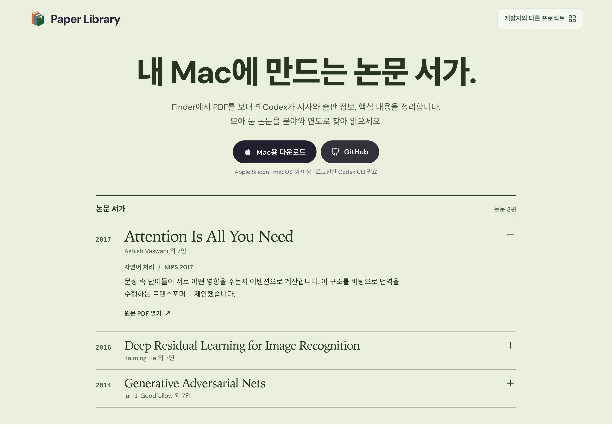

# Paper Library

Finder에서 논문 PDF를 보내면 Codex가 저자, 출판 정보와 핵심 내용을 정리합니다. 내 Mac에 모아 둔 논문을 분야와 연도로 찾아 다시 읽으세요.

**[논문 서가에서 요약 펼쳐보기 ↗](https://paper-library.pages.dev/)**

Apple Silicon · macOS 14 이상 · 논문 정리에는 로그인된 Codex CLI가 필요합니다.

[개발 가이드](docs/DEVELOPMENT.md) · [배포 안내](docs/DISTRIBUTION.md)
