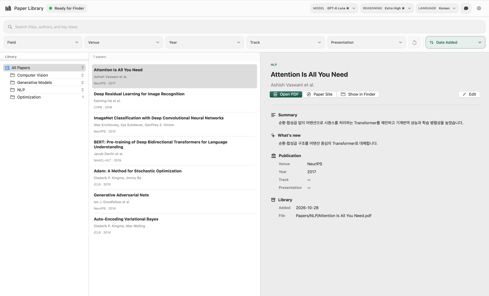

# Paper Library

**PDF를 모으고, 읽고, 다시 찾는 macOS 논문 라이브러리입니다.**

Finder에서 논문을 추가하면 Codex가 요약과 출판 정보를 정리해요. 분야·학회·연도별로 찾아보고, 필요한 PDF를 바로 열 수 있습니다.

현재 앱 화면 · 실제 논문으로 구성한 예시 라이브러리입니다.

## 주요 기능

- **Finder에서 추가** — PDF를 우클릭하고 `서비스 → Move to Paper Library`를 선택해요.
- **요약과 분류** — 요약, 새로운 기여, 출판 정보와 분야를 함께 정리해요.
- **검색과 필터** — 제목·저자·핵심 내용을 검색하고 분야·학회·연도 등으로 좁혀요.
- **내 방식으로 수정** — 메타데이터를 직접 편집하거나 Codex에 정리 요청을 보낼 수 있어요.

## 설치·시작하기

macOS 14 이상이 설치된 Apple Silicon Mac과 로그인된 [Codex CLI](https://developers.openai.com/codex/cli)가 필요합니다. 현재는 초기 베타 버전이에요.

1. [최신 릴리스](https://github.com/hoonably/paper-library/releases/latest)에서 DMG를 받아 열고, **Paper Library를 Applications로 드래그**해요. 이전 릴리스에 ZIP만 있다면 압축을 풀어 앱을 응용 프로그램 폴더로 옮겨주세요.
2. 앱을 열고 저장 위치 안내에서 **Continue**를 눌러요. macOS가 문서 폴더 접근을 요청하면 허용해요.
3. 요약 언어를 선택하고, 필요하면 **Sign In**으로 로그인해요. **Codex CLI is ready**가 표시되면 **Finish Setup**을 눌러요.
4. Finder에서 PDF를 우클릭하고 **서비스 → Move to Paper Library**를 선택해요.

PDF는 복사되지 않고 처리 대기 공간으로 **이동**합니다. 정리 작업은 추가할 때만 시작하고 완료되면 종료돼요. 상시 폴더 감시는 하지 않습니다.

Apple 공증을 받지 않은 빌드가 차단되면 **시스템 설정 → 개인정보 보호 및 보안 → 그래도 열기**를 사용해 주세요. 배포 파일의 서명·공증 상태는 해당 릴리스 설명에서 확인할 수 있어요.

## 저장 위치와 권한

PDF는 `문서/Paper Library/Papers`, 목록과 설정은 이 Mac의 앱 전용 저장소에 보관해요. PDF 동기화는 문서 폴더 설정을 따르며, 업데이트해도 기존 논문과 목록은 유지됩니다.

**문서 폴더 접근만 필요하며 전체 디스크 접근은 요청하지 않아요.** 권한을 거절했다면 앱 안내의 **Open Settings**에서 문서 폴더 접근을 켠 뒤 **Try Again**을 눌러요. 저장 위치와 권한 안내는 **Settings → Library**에서도 확인할 수 있어요.

추가한 PDF의 자동 정리에는 로그인한 Codex 계정을 사용합니다. 앱의 모델·추론·요약 언어 메뉴에서 다음 논문에 사용할 설정을 바꿀 수 있어요.

## 업데이트

**Paper Library → Check for Updates…** 또는 **Settings → Updates**에서 새 버전을 확인해요. **Notify me about updates automatically**를 켜면 앱 실행 중 새 버전을 자동으로 확인하고 알려줘요. 이 체크는 자동 다운로드·설치를 켜지 않습니다.

업데이트는 기존 Sparkle 서명 검증을 거쳐 설치됩니다. 앱에서 진행 중인 자동화 설정·라이브러리 수정은 마친 뒤 앱을 다시 시작해요. 새로 설치할 때는 DMG를, 앱 내부 업데이트에는 ZIP을 사용해요.

## 개발·배포 안내

[개발 가이드](docs/DEVELOPMENT.md) · [배포 가이드](docs/DISTRIBUTION.md) · [릴리스 문구](docs/RELEASE_NOTES.md)

개발: [Jeonghoon Park](https://jeonghoonpark.com)
